Estudiante de desarrollo de software, Llego a la programación después de 3 años en servicio al cliente y soporte, donde aprendí a pensar en quien usa el sistema y en los datos que lo sostienen.

- **3 años en Gestión de PQRS.** Manejo de bases de datos, monitoreo de pasarelas de pago, soporte a agentes de primer nivel y a aliados del cliente. Desplegaba y corregía la información que usaban los agentes y daba inducciones de mejora continua en reconocida aplicación con presencia en 7 países.

  
  
  

### Tecnologías y herramientas

**Lenguajes** 

**Frontend** 

**Backend y bases de datos** 

**Herramientas** 

### Actividad

  
  

<!-- La serpiente la genera a diario el flujo .github/workflows/serpiente.yml en la rama "output". -->
<picture>
  <source media="(prefers-color-scheme: dark)" srcset="https://raw.githubusercontent.com/dexter-mouser/dexter-mouser/output/serpiente-oscura.svg">
  
</picture>
